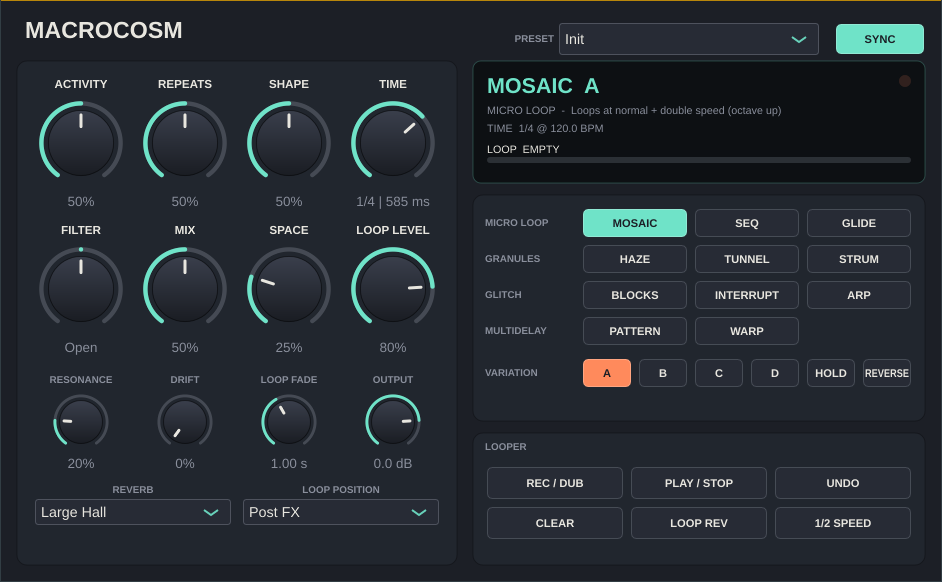

# Macrocosm

A free, open-source granular / micro-loop / glitch / multidelay effect plugin with a phrase looper, closely modelled on
the **Hologram Electronics Microcosm** pedal. It builds as **VST3 on Windows** and **VST3 + AU (Universal: Apple Silicon + Intel) on macOS**,
plus a standalone app. Both load in Ableton Live.



> Not affiliated with or endorsed by Hologram Electronics. "Microcosm" is their trademark. This project is an
> independent re-creation of the effect's concept, so it ships under a different name. It also deliberately goes further
> than the pedal in places, with Shimmer and Cathedral reverbs, Drift and factory presets, for cinematic textures.

## Install in Ableton Live

### Windows
1. Download `Macrocosm-Windows-x64.zip` from the latest GitHub Actions run (**Actions → Build → Artifacts**) or from a
   tagged **Release**.
2. Copy `Macrocosm.vst3` into `C:\Program Files\Common Files\VST3\`.
3. In Live: **Options → Preferences → Plug-Ins**, turn on **Use VST3 Plug-In System Folders**, then click **Rescan**.
4. Find it under **Plug-Ins → Macrocosm Audio → Macrocosm** and drop it on an audio track or a return track.

### macOS
1. Download `Macrocosm-macOS-Universal.zip`.
2. Copy `Macrocosm.vst3` to `~/Library/Audio/Plug-Ins/VST3/` and/or `Macrocosm.component` to
   `~/Library/Audio/Plug-Ins/Components/`.
3. The build is ad-hoc signed, not notarized. If macOS blocks it, run:
   `xattr -dr com.apple.quarantine ~/Library/Audio/Plug-Ins/VST3/Macrocosm.vst3 ~/Library/Audio/Plug-Ins/Components/Macrocosm.component`
4. In Live, enable VST3 and/or Audio Units under **Preferences → Plug-Ins** and rescan.

## The effect

Eleven algorithms in four families. Each has four variations (A–D), for 44 presets in total.

| Family | Algorithm | What it does | A | B | C | D |
|---|---|---|---|---|---|---|
| Micro Loop | **Mosaic** | Overlapping micro-loops at different speeds | 1× + 2× (octave up) | 1× + ½× (octave down) | 1×/2×, some reversed | Chaotic speeds & directions |
| | **Seq** | Recent audio sliced and re-sequenced | Filtered slices | 1× + ½× slices | Filter-swept slices | Lo-fi, reversed, pitched |
| | **Glide** | Loops whose pitch glides | ½× → 1× | 2× → ½× | 1× → 2× | Random glides |
| Granules | **Haze** | Smeared grain clouds | Plain cloud | + octave-up shimmer | + octave-down grains | Reversed, detuned |
| | **Tunnel** | Drones from cyclical micro-loops | Breathing filter | Octave-down, swept | Resonant band-pass | + octave-up layer |
| | **Strum** | Rhythmic chains of recent notes | Repeats last note | Phasing copies | Cascade of recent notes | Cascade + octave-up |
| Glitch | **Blocks** | Rearranged, stuttered blocks | Bursts / ratchets | Pitched | Soft, filtered | Pitched + bit-crushed |
| | **Interrupt** | Bursts that *replace* the dry signal | Rearranged | Pitched | Filter sweeps | Crushed |
| | **Arp** | Each note becomes an arpeggio | Octaves | 3rds, 5ths, octaves | Stepped band-pass | Crushed |
| Multidelay | **Pattern** | Rhythmic multi-tap delay | Straight | Syncopated | Clusters | Triplets |
| | **Warp** | Multi-tap delay with processed taps | Envelope filters | Resonant band-passes | Pitch-shifted taps | Octave-up grain taps |

Strum, Arp and Tunnel react to note onsets in your playing. A detector picks up each new attack.

### Controls

| Control | Function |
|---|---|
| **Activity** | Density: how many loops, grains, slices or taps are active. Also how busy the glitches are. |
| **Repeats** | Duration: loop lifespan, drone decay, number of strums or arp steps, delay feedback. |
| **Shape** | Volume contour of each event: percussive (left), flat (centre), swelling (right). In Pattern/Warp it contours how each note feeds the echoes (plucky ↔ swelling) and tilts the tap levels. |
| **Time** | The rhythmic unit. With **Sync** on it is a note value locked to Live's tempo and grid (1/32 … 1 bar). With Sync off it is a free time (50 ms – 2 s). |
| **Filter** | Centre is open. Left is a low-pass, right is a high-pass. **Resonance** sets the peak. Applies to the effect only. |
| **Mix** | Dry/wet. At the centre both are at full level, as on the pedal. |
| **Space** | Reverb amount. **Reverb** mode: Bright Room, Dark Medium, Large Hall, Ambient, plus **Shimmer** (octave-up pitch shifting inside the reverb, so the tail keeps rising) and **Cathedral** (huge and long). |
| **Drift** | Tape-style wow, flutter and slow pitch wander on the effect, slightly different per side. Around 15–40% gives gentle movement; higher gives lo-fi warble. |
| **Hold** | Freezes the audio the effect is working on, so it keeps generating from what you just played while you play over it. In the delays it becomes an infinite repeat. |
| **Reverse** | Plays every loop, grain and tap backwards. |
| **Output** | Output trim (dB). |

### Factory presets

Pick these from the **Preset** menu at the top of the plugin, or from Live's program list. They're cinematic starting points for guitar:
Shimmer Cathedral, Frozen Swell, Reverse Bloom, Granular Choir, Tape Memory, Octave Clouds, Rising Tide, Ghost Echoes,
Crystal Arp, Distant Signal and Infinite Pad. Choosing one sets the effect and sound controls; the looper is left alone.

### Sound quality notes

- Loops, grains and echoes that play faster than normal (octave-up) read from band-limited copies of the audio, so they
  don't alias into harsh, fizzy tones.
- Pitch-shifted echoes (Warp C/D) and the Shimmer reverb use a grain pitch shifter that lines up each new grain with
  the waveform it crossfades into. That way sustained notes shift cleanly without the dropouts and warble of a basic shifter.

### Looper (60 s, stereo)

| Button | Function |
|---|---|
| **Rec / Dub** | 1st press: record. 2nd press: close the loop and start overdubbing. While overdubbing: back to play. |
| **Play / Stop** | Closes a recording and plays. Stops with a fade (**Loop Fade** sets its length). Restarts. |
| **Undo / Redo** | Removes or restores the last overdub. |
| **Clear** | Erases the loop. |
| **Loop Rev / ½ Speed** | Reverse and half-speed (octave down) playback. |
| **Loop Level** | Loop playback volume. |
| **Loop Position** | *Post FX* records the processed output. *Pre FX* records your dry input and runs the loop through the effects. |

All looper buttons are also exposed as automatable trigger parameters, so you can MIDI-map them in Live. Click
**Configure** on the device, then the button, then use MIDI Map mode. Parameter changes are fully automatable, and state is
saved with your Live set. Loop audio is not saved.

## Building from source

Requirements: CMake 3.22+ and a C++17 compiler. JUCE 8 is downloaded automatically.

**Windows** (Visual Studio 2022 or newer with "Desktop development with C++"):
```
cmake -B build -A x64
cmake --build build --config Release
```
The plugin is written to `build\Macrocosm_artefacts\Release\VST3\Macrocosm.vst3`.

**macOS** (Xcode):
```
cmake -B build -G Xcode
cmake --build build --config Release
```
The build is universal (`arm64;x86_64`) by default.

**Linux**: install the JUCE dependencies (`libasound2-dev libx11-dev libxrandr-dev libxinerama-dev libxcursor-dev libfreetype-dev libfontconfig1-dev`), then:
```
cmake -B build -DCMAKE_BUILD_TYPE=Release && cmake --build build
```

Run the headless DSP test with `ctest --test-dir build -C Release`. It renders all 44 presets, extreme settings,
Hold and the looper, and checks for silence, NaNs and runaway levels.

CI (`.github/workflows/build.yml`) builds every platform and runs the DSP test and
[pluginval](https://github.com/Tracktion/pluginval) at strictness 8. On macOS it also runs `auval`. Pushing a tag such as
`v1.0.0` publishes a GitHub Release with the Windows and macOS zips.

## Code layout

```
Source/
  dsp/            framework-free DSP (unit-testable)
    Engine.h        the 11 algorithms + scheduler, onset detection, clock
    Voice.h         micro-loop / grain playback head (glide, filter, crush, envelopes)
    HistoryBuffer.h 32 s input recorder that loops and grains read from (frozen by Hold)
    MultiTap.h      Pattern / Warp multi-tap delay with per-tap processing
    Reverb.h        8-line FDN reverb, 6 modes incl. Shimmer
    PitchShifter.h  WSOLA-aligned grain pitch shifter (Warp, Shimmer)
    Drift.h         tape wow/flutter on the effect signal
    Looper.h        phrase looper with undo/redo
    MicrocosmDsp.h  full signal chain
  Parameters.h    parameter IDs and layout
  Presets.h       factory presets
  PluginProcessor.*, PluginEditor.*  JUCE wrapper and UI
tests/DspTest.cpp
```
